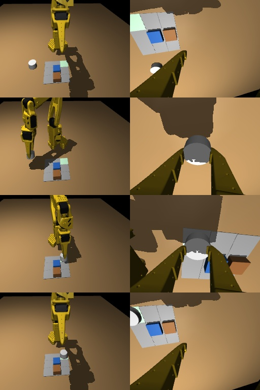

# Agent S: pretrained SmolVLA placement handoff

October 25, 2026. Hardware deployment is **HOLD**. A real pretrained SmolVLA
was fine-tuned, exported and evaluated, but the available checkpoint has not
demonstrated reliable placement. The supplied expert convention also starts
outside the current bench's wrist-flex limit. No robot motion or live Gemini
request was made by S. Inference deployment does not authorize robot motion.

Final S3 results are **1/30 clean (3.33%) and 0/30 real noise**. S2 scored
0/30 in both settings. The persistent S3 checkpoint is deployed as a loopback
inference service and passed an actual-weight RPC smoke test. This does not
complete the goal of reliable autonomous real-arm placement.

## Dataset and pretrained initialization

- Source: 400 successful episodes from `/dev/shm/r2p/wide_ok`, seeds 200001
  through 200518 with unsuccessful/missing seeds omitted. Source file hashes
  and the exact seed list are in the export's `dataset_manifest.json`.
- 254,874 source control ticks; 43,643 paired observations, or 87,286 RGB
  images. Sample every sixth observation and at command boundaries; each
  label remains 15 consecutive absolute servo targets at 30 Hz.
- Rendering took 57.38 seconds. Data is at
  `/dev/shm/r2p_s/dataset400_calibrated` on `cube@100.68.107.11`.
  This RAM-backed image dataset is temporary. All 400 source traces are also
  preserved as regular files in the persistent checkpoint's
  `source_traces.tar.gz` (83,480,144 bytes compressed; 733,199,651 source
  bytes), so they can be rendered again. The frozen manifest and normalization
  are bundled with the checkpoint.
- The dataset freezes its source task, physical twin, start pose and
  conventions. It is not relabeled as the later bench survey. Joint and object
  poses, including quaternions, come from physical expert contact rollouts.
- Scene camera: calibrated `config/camera.json`, rectified pinhole. The
  measured four-marker projection error is at most **0.278 pixels** at
  256x192. The wrist camera uses the measured Innomaker gripper mount; wrist
  distortion and remaining optical-axis uncertainty are not calibrated.
  The initial audit caught a principal-point sign error; that initial dataset
  and short training attempt were discarded before the reported S2/S3 runs.
- Inputs: two RGB cameras, six last-commanded joints (reset to measured if any
  joint differs by more than four degrees), command age, and language.
  Collection and runtime share the same Argon-command translator.
- Actual dataset mean/std normalization is applied to state and action, with
  the required constant-feature clamps. Image feature names match exactly.
- Pretrained model: `lerobot/smolvla_base`, revision
  `c83c3163b8ca9b7e67c509fffd9121e66cb96205`; base weights SHA256
  `7cd549ac2351fb069c0ddb3c34ad2d09cfc92b56a15dccdfc2e41467aaca01eb`.
  Backbone: `HuggingFaceTB/SmolVLM2-500M-Video-Instruct`, revision
  `7b375e1b73b11138ff12fe22c8f2822d8fe03467`. All model tensors are restored
  from pretrained weights; missing policy tensors are refused.



## Training and closed-loop evidence

Training uses the lead-assigned lease `apt_e05759e0`, GPU 0 of
`squaredcube1-ubuntu`, a 0.167 PyTorch memory fraction and 60% duty budget.
The ledger was live with no unleased GPU-0 usage when checked. No new GPU or
machine was rented. Batch size is 64; 99,880,992 action-expert parameters are
trainable and the pretrained VLM is frozen.

| Candidate | Updates | Training seconds | Input padding | Clean | Real noise |
| --- | ---: | ---: | ---: | ---: | ---: |
| S2 | 3,000 | 649.11 | 256 | 0/30 | 0/30 |
| S3 | 1,356 more; 4,356 total | 840.92 | 512 | 1/30 | 0/30 |

S2 used AdamW at 1e-4, 50-step warmup, gradient norm cap 10 and BF16 on CUDA.
Its loss fell from 0.619984 to 0.032308, with 5.576 GiB peak PyTorch allocation.
S3 continues S2 with an explicitly restarted optimizer at 5e-5, brightness and
pixel-noise augmentation, and the pretrained model's 512-pixel padding size.
The saved model configuration preserves that size when reloaded.
S3's loss fell from 0.228258 to 0.030418 and peak PyTorch allocation was
11.221 GiB. The two reported training stages total **1,490.04 seconds
(24.83 minutes)**, including periodic checkpoint saves, excluding dependency
setup, discarded preliminary work and evaluation.

Both evaluations use the same 30 held-out scene seeds 10000..10029, with no
training-seed overlap, 1,200 control ticks maximum, six episodes per batch and
replanning every 15 ticks. The simulator uses physical contacts, configured
sag/servo latency and the shared half-second `check_window` success checker.
The VLA receives images, joints and language, never object-coordinate slots.
The command scheduler uses simulator state and is explicitly **not a live
Argon evaluation**. Real noise means simulated 1.5-degree joint calibration
error, one extra latency tick, brightness 0.9..1.1, pixel noise sigma 2, blur
probability 0.2, and stale-camera probability 0.3 with at most seven ticks of
staleness. It does not mean real-camera or real-robot validation.

S2's mean batched inference time was 80.8 ms clean and 80.2 ms noisy, before
lease-duty sleep. Its evaluations took 90.57 and 97.34 seconds. An inspected
rollout attempted the grasp several centimetres from the cap. Low training
loss therefore did not establish useful visual closed-loop control.

S3's clean success was seed **10020**, at tick 420 (14 simulated seconds),
with all shared success predicates satisfied. The clean suite took 104.42
seconds; mean batched inference was 96.2 ms before duty sleep. The final S3
weights SHA256 is
`460a0a07848b87864e375a8f933454af87d62b0311899c407c14fc4257d71445`.
The noisy suite took 104.15 seconds with 92.5 ms mean batched inference.
On 128 training observations, teacher-forced chunk MAE was 0.021842 radians
and first-action MAE was 0.017182 radians. Those errors and image/language
sensitivity measurements are diagnostic only; the closed-loop counts above
determine the result.

Late handoff context: P2's state-policy report identifies a mismatch between
expert command boundaries and the earlier transitions of `CommandTracker`.
S3 retains the expert's command labels/clocks, so that timing mismatch remains
an additional limitation for later subtasks; it does not by itself explain
all of the failed initial picks. P2 also uses an arm-only reset, whereas this
VLA follows the supplied binding rule to reset on divergence of any of six
joints. Neither change was silently applied to the evaluated weights. Future
retraining must resolve the command-boundary and reset conventions as well as
visual control. See `r2p/policy/P2_POLICY_STALLS_REPORT.md`.

## Export and inference deployment

Persistent rig checkpoint: `/home/cube/real2play/exports/smolvla_cell_s3`.
The S2 comparison checkpoint is in the sibling `smolvla_cell_s2` directory.
Each full checkpoint bundles tokenizer/backbone configuration, model weights,
training statistics, frozen source manifest, camera calibration, declared
start and absolute-action convention, and recorded evaluations. Weight hashes
are verified on load and attached to evaluation results.

The Torch-free `r2p.vla.client.RemotePolicy` and
`r2p.vla.adapter.SessionPolicy` expose a `(15, 6)` absolute-target chunk to the
existing guarded runner. The caller must provide synchronized measured joints,
scene/wrist frames and control ticks through `observe`, and forward Argon's
explicit commands through `set_command`. `argon_command` uses cached MAIN
requests through the existing Gemini client. Unit tests inject a fake request.
Automatic live camera acquisition and a live Argon/robot control campaign
were not performed.

Exact inference deployment command on the rig, after confirming this assigned
lease is still active for the service's entire 1,800-second lifetime:

```sh
cd /home/cube/real2play
CUDA_DEVICE_ORDER=PCI_BUS_ID CUDA_VISIBLE_DEVICES=0 \
LANDLORD_LEASE_ID=apt_e05759e0 \
PYTHONPATH=/home/cube/r2p_vla_S_20261025_deps:/home/cube/r2p_deps \
HF_HUB_OFFLINE=1 TOKENIZERS_PARALLELISM=false \
OPENBLAS_NUM_THREADS=1 OMP_NUM_THREADS=4 \
/home/cube/venvs/diag/bin/python -u -m r2p.vla.serve \
  --export /home/cube/real2play/exports/smolvla_cell_s3 \
  --device cuda:0 --memory-fraction .167 --gpu-duty .60 \
  --max-seconds 1800 --port 9106
```

On the bench, forward the loopback endpoint with
`ssh -N -L 9106:127.0.0.1:9106 cube@100.68.107.11`. A concrete Argon-to-chunk
command using captured frames is:

```powershell
.venv/Scripts/python.exe -m r2p.vla.client --url http://127.0.0.1:9106 --scene scene.jpg --wrist wrist.jpg --state state.json --cell r1c2 --argon --out chunk.json
```

This makes one live Argon request and writes targets to a file; it does not
move the robot. `state.json` contains `q`, `q_measured`, `tick` and optionally
`command_age_s`. Use `--command 'pick(piece)'` instead of `--argon` for an
offline command. The service never opens the robot bus. It binds loopback,
reports `deployment_qualified: false`, and stops at its configured deadline.

The service was actually started at approximately **14:42 PDT**, PID **53923**,
and will stop around **15:12 PDT**, within the checked lease. Its log and PID
are in the persistent S3 export. The smoke test verified the expected weights
hash, saved 512-pixel configuration, and three finite `(15,6)` responses.
Round trips on the rig were 0.494 seconds cold and 0.141/0.136 seconds warm,
including the lease-duty wait. It used a fake Argon MAIN response with
`R2P_CACHE_ONLY=1`, not a live Gemini request. These local rendered-image
timings do not establish 30 Hz camera/network/robot execution on the bench.

The checkpoint is kept on persistent rig storage because the measured laptop
download rate was about 0.33 MB/s, insufficient to retrieve the full weights
before this deadline. Small evidence and configuration files are mirrored
locally under `runs/S_vla_evidence` and versioned under `r2p/vla/evidence`.
The versioned `evidence/final/config.json` is metadata for inspection and the
read-only qualification command; full model weights remain on the rig.

## Hardware qualification and checks

The source start's compensated wrist flex is **113.829 owner degrees**;
the current physical upper bound is **101.8 degrees**. This is refused before
motion. Fresh expert probes under the current bench profile also produced
0/8 successes (six grasp misses, two drops during carry), so there was no
successful replacement corpus to train within this run. Existing targets were
not clipped or rotated into a different hardware convention.

```powershell
.venv/Scripts/python.exe -m pytest -q tests/vla
.venv/Scripts/python.exe scripts/robot/S_vla_check.py --export r2p/vla/evidence/final --out runs/S_bench_gate.json
```

Unit acceptance: **10 passed**; compilation and scoped diff checks also passed.
The hardware qualification command returned exit code 1 and
`deployment_qualified: false`. Tests cover the shared
language mapping, real normalization, command-boundary chunk padding, absolute
targets, commanded-state reset and clock behavior, fake Argon MAIN requests,
camera adapter channel order, GPU lease refusal, and physical twin latency
with the actual success checker.

Files: `r2p/vla/` contains collection, rendering, audit, fine-tuning, loading,
evaluation, diagnostics, RPC and runner adapters; `scripts/robot/S_*.py`
contains offline weight/dependency staging and the read-only bench gate;
`tests/vla/` contains the acceptance tests. Dependencies are in the `vla` and
`vla_prep` extras in `pyproject.toml`. Initial implementation commit:
`90051fc`; the final evidence/report commit is reported in the handoff.

Not done: reliable 30-scene placement performance, a hardware-compatible
trained start/convention, real visual-domain validation, measured 30 Hz
hardware execution, or live Argon-controlled arm placement. Completing those
requires successful expert data under the calibrated bench profile and
further visual-policy training and validation.
